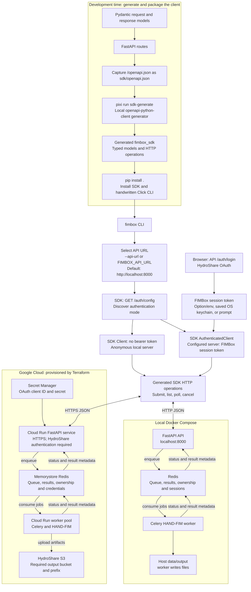

## Local quickstart (no configuration or login)

From a fresh clone, start the stack:

```bash
docker compose up --build
```

In another terminal, from the repository root (Python 3.10+):

```bash
pixi run sdk-generate
python -m pip install .
fimbox submit --body test-data/single_reach.json
fimbox jobs
fimbox status --job-id JOB_ID
```

No `.env`, OAuth credentials, session token, or keychain setup is needed.
The worker writes output temporarily under `data/output/scenarios/<job_id>/`;
every job removes its local files when it finishes. Supply an S3 destination
to retain artifacts; local-only jobs return metadata but no retained files. The initial
image build and watershed downloads require network access.

With neither OAuth client ID nor secret configured, the server uses a shared
local identity. Anyone who can reach it can submit, view, or cancel
local jobs. Compose binds the API to loopback; keep this mode limited to trusted,
single-user local use. Local jobs remain separate from authenticated users'
jobs if authentication is enabled later.

## Google Cloud deployment with Terraform

[`terraform/`](terraform/) adapts the Cloud Run API/worker-pool, Memorystore,
VPC/private service access, Artifact Registry, IAM, and Secret Manager resources
from [CUAHSI/fimbox-api](https://github.com/cuahsi/fimbox-api/tree/b6ddd220bd72c950cfa16a6f76bf3de3a54acd11/terraform).
The API and HAND-FIM worker use **separate images** from this repository.

**This deployment always requires HydroShare authentication and S3 output.**
The API gets both OAuth credentials from Secret Manager and
`REQUIRE_HYDROSHARE_OUTPUT=true`. Missing credentials prevent startup.
The submission endpoint rejects jobs without `output_bucket` before
credential exchange or enqueueing. The endpoint is publicly reachable for
browser OAuth, but job access is protected by FIMBox sessions and ownership.
The worker gets per-job temporary S3 credentials from Redis, not OAuth client
secrets or static AWS credentials. Local Compose defaults remain unchanged.

### 1. Bootstrap infrastructure

Requirements: a billed GCP project, Google Cloud CLI, Terraform 1.5+, Docker,
permission to enable services and manage these resources, and availability/
quota for Cloud Run worker pools in the selected region. Provisioning creates
billable resources, even before workers start.

```bash
gcloud auth application-default login
cp terraform/terraform.tfvars.example terraform/terraform.tfvars
```

Set `project_id` (and desired region/name/environment) in the copied file.
Leave `deploy_services=false` initially.
Configure `s3_endpoint_url` (default `https://s3.hydroshare.org`) for both API
signing and worker uploads. An alternative endpoint must accept the credentials
issued by HydroShare's service-account API; this does not change that API.

```bash
terraform -chdir=terraform init
terraform -chdir=terraform plan
terraform -chdir=terraform apply
```

Terraform does not build images or read the repository's `.env`. OAuth secret
containers are created empty when both credential variables are null. Optionally
set both `hydroshare_client_id` and `hydroshare_client_secret` in your ignored
tfvars file to create Secret Manager versions automatically. These inputs are
sensitive (redacted from normal CLI output) but **their values are stored in
Terraform state and saved plans**. Never commit credential files, state, or plans.
Alternatively populate credentials externally as described below to keep OAuth
values out of state. Queue URLs always enter state.
Use a secured remote state backend and restricted project/IAM permissions for
production; the example uses local state, which must not be committed.

### 2. Build and push Linux/amd64 images

After the bootstrap apply, run:

```bash
bash terraform/build_push_images.sh release-20261011
```

The script reads `registry_url` from Terraform state, configures the gcloud
Docker credential helper, builds both Linux/amd64 images, and pushes them.
Use a new tag for each release. Docker must be running and gcloud must be
authenticated with permission to upload to the repository. It prints
`api_image` and `worker_image` assignments only after both pushes succeed;
copy those into tfvars and enable `deploy_services`. It does not edit tfvars
or apply Terraform. On failure, it stops immediately; if one push already
succeeded, that image remains in the registry. The script works from any
directory when invoked using its full path.

The equivalent manual commands are:

Run from the repository root, replacing the project and region below with the
values from your Terraform variables:

```bash
export PROJECT_ID=YOUR_GCP_PROJECT
export REGION=us-central1
export REGISTRY="$(terraform -chdir=terraform output -raw registry_url)"
gcloud auth configure-docker "$REGION-docker.pkg.dev"

docker build --platform linux/amd64 \
  -f docker/api/Dockerfile -t "$REGISTRY/api:v1" .
docker build --platform linux/amd64 \
  -f docker/api/worker.Dockerfile -t "$REGISTRY/worker:v1" .
docker push "$REGISTRY/api:v1"
docker push "$REGISTRY/worker:v1"
```

The worker build extends `cuahsi/handfim:latest`; it does not use the slim API
image. Use immutable digests or unique release tags for subsequent deployments.
If these images are stored in another project/repository, grant its pull
permissions to the appropriate Cloud Run service agent as well.

### 3. Populate HydroShare credentials

Register a confidential HydroShare OAuth application. To manage credentials
through tfvars, replace the null values with the client ID and plaintext secret:

```hcl
hydroshare_client_id     = "YOUR_OAUTH_CLIENT_ID"
hydroshare_client_secret = "YOUR_PLAINTEXT_OAUTH_CLIENT_SECRET"
s3_endpoint_url         = "https://s3.hydroshare.org"
```

Supply both credentials or neither; partial and empty values fail validation.
Terraform creates new Secret Manager versions on changes and pins the API to
those specific versions. `oauth_secret_version` is ignored in this mode.
Only the API reads the OAuth secrets; the worker still uses per-job credentials.
Protect the tfvars file and state. Switching between Terraform-managed and
externally populated credentials may destroy managed versions; inspect the plan
and provision replacement external versions before removing the inputs.

For external secret management, leave both variables null and add its client ID and
**plaintext client secret** to the provisioned secrets, without putting values
on the command line or into Terraform. The following Bash commands read them
without echoing:

```bash
read -r -s -p 'HydroShare client ID: ' OAUTH_ID; printf '\n'
printf '%s' "$OAUTH_ID" | gcloud secrets versions add \
  "$(terraform -chdir=terraform output -raw oauth_client_id_secret)" \
  --project="$PROJECT_ID" --data-file=-
unset OAUTH_ID

read -r -s -p 'HydroShare client secret: ' OAUTH_SECRET; printf '\n'
printf '%s' "$OAUTH_SECRET" | gcloud secrets versions add \
  "$(terraform -chdir=terraform output -raw oauth_client_secret_secret)" \
  --project="$PROJECT_ID" --data-file=-
unset OAUTH_SECRET
```

For external management, the default `oauth_secret_version=1` pins both secrets' initial versions. When
rotating, add corresponding versions of both credentials, update the variable,
and apply. The API runtime alone has access to these secrets.

### 4. Deploy and register HTTPS callbacks

Update the copied variables:

```hcl
deploy_services = true
api_image       = "REGISTRY_FROM_OUTPUT/api:v1"
worker_image    = "REGISTRY_FROM_OUTPUT/worker:v1"
```

Run `terraform -chdir=terraform plan`, then `terraform -chdir=terraform apply`.
Obtain the generated HTTPS API URL:

```bash
terraform -chdir=terraform output -raw api_url
```

Set `public_api_url` to that origin **without a trailing slash** and apply again.
The initial `configure-before-login.invalid` value deliberately disables usable
OAuth redirects until this step; do not try logging in before updating it.
Alternatively, use a custom HTTPS origin that you have configured separately.
Register these exact URLs on the HydroShare OAuth client:

- `<public_api_url>/auth/callback`
- `<public_api_url>/docs/oauth2-redirect`

Then install the client and submit with a HydroShare S3 bucket:

```bash
python -m pip install .
export FIMBOX_API_URL="$(terraform -chdir=terraform output -raw api_url)"
curl --fail "$FIMBOX_API_URL/auth/config"
fimbox submit --body test-data/single_reach.json \
  --output-bucket YOUR_HYDROSHARE_BUCKET --output-prefix fimbox
```

Authentication discovery must return `{"authentication_enabled":true}`.
The CLI links to browser login and saves the resulting FIMBox session token.
Outputs are uploaded to the supplied HydroShare bucket and prefix; the API
does not provide artifact download endpoints. There is no shared local-output
mount in Cloud Run.

### Capacity and lifecycle

`api_min_instances` (default 0), `api_max_instances` (5), `api_concurrency` (80),
and `api_timeout_seconds` (60) configure API scaling and request handling.
Minimum instances cannot exceed maximum instances. The API timeout applies to
HTTP requests, not the asynchronous scientific job duration.

The worker pool is always running (default one worker, 4 CPUs, 16 GiB memory),
not request-driven or automatically scaled by queue length. CPU/memory and
instance count are configurable. Cloud Run's writable filesystem is ephemeral
and **counts against memory**: HAND-FIM watershed caches, intermediate rasters,
and outputs must fit alongside scientific processing. Jobs remove their inputs,
downloaded HUC data, temporary files, intermediate rasters, and final local outputs
on both success and failure. A forced termination/OOM kill cannot run cleanup;
replace affected workers if files remain. Large workloads may need a persistent-disk/NFS
or Compute Engine deployment instead. S3 uploads preserve completed artifacts,
not computation scratch state. This Terraform does not provision Filestore.

Set `result_ttl_seconds` above the longest job duration; it also controls broker
visibility timeout. Redis is BASIC tier and metadata is TTL-based, not a durable
job archive. S3 credentials and sessions expire independently. Worker replacement
may redeliver jobs; it cannot safely interrupt an active scientific subprocess.
Do not scale down or destroy the stack during active work.

Validate infrastructure without creating resources:

```bash
terraform -chdir=terraform init -backend=false
terraform -chdir=terraform fmt -check
terraform -chdir=terraform validate
# Mock-provider contract tests require Terraform 1.7+:
terraform -chdir=terraform test
bash tests/test_build_push_images.sh
```

Inspect `terraform -chdir=terraform plan -destroy` before intentionally removing
infrastructure. Terraform does not remove artifacts already uploaded to HydroShare.

## Building Docker Images

```
docker build --platform linux/amd64 -t cuahsi/handfim:latest docker/handfim
```

## HAND-FIM API and worker

The `src/fimbox_api` package adapts the application template from
[CUAHSI/fimbox-api](https://github.com/cuahsi/fimbox-api/tree/b6ddd220bd72c950cfa16a6f76bf3de3a54acd11/code).
It keeps FastAPI, Celery, Redis, job submission, status polling, and queued-job
cancellation, replacing the demonstration task with HAND-FIM. The template's
GCP deployment is adapted in [`terraform/`](terraform/) as described above.
HydroShare OAuth and Redis sessions are adapted from the template's
[`authentication` branch](https://github.com/cuahsi/fimbox-api/tree/5da02c2171aca24ab69a0687be64b730e4d0272c).

Start the local stack from the repository root:

```bash
docker compose up --build
```

The main Compose file runs API, worker, and Redis. The base HAND-FIM image
can be built separately as shown above. The Compose project name remains `api` to preserve
existing containers and sessions; no data migration is needed.

The API is available at `http://localhost:8000`, with interactive documentation
at `/docs`. Redis is internal to the stack. The worker image extends
`cuahsi/handfim:latest` and invokes `/home/entry.py scenario` directly; it does
not need access to the Docker socket. Build the existing HAND-FIM image first
if you want to use a locally rebuilt base.

### HydroShare authentication

Authentication is configuration-driven: neither client ID nor secret enables
local mode; providing both enables mandatory session authentication for job
routes. Providing only one fails startup with an explicit configuration error.
`GET /auth/config` reports `{"authentication_enabled": false}` or `true`.
The CLI discovers this setting and, in local mode, neither prompts for a token,
accesses the keychain, nor sends a supplied token. Discovery failures are
reported, not treated as permission to bypass authentication.
Local mode has no login/logout session to manage (`logout` returns HTTP 409).
HydroShare S3 output requires configured authentication and a valid user session;
anonymous S3 submissions return HTTP 409 without enqueueing.

Register a confidential OAuth client with HydroShare and configure
`HYDROSHARE_CLIENT_ID` and `HYDROSHARE_CLIENT_SECRET` in the root `.env`
for Compose, or in your environment for host-side execution
(never commit credentials).

`API_CLIENT_ID` and `API_CLIENT_SECRET` are also accepted as aliases in the
root `.env` file; the `HYDROSHARE_CLIENT_*` settings take precedence. Compose
loads this optional file into the API with `format: raw` (Compose 2.30+), so
credential values must be literal and unquoted, including any `$` characters.
Swagger's
**Authorize** dialog at `/docs` prefills the configured client ID. Leave its
client-secret field blank: `/auth/oauth/token` uses the configured secret
server-side when exchanging the authorization code with HydroShare. The
secret is never embedded in the Swagger page or sent to the browser.

After adding or changing credentials, recreate the API to load them:

```bash
docker compose --env-file /dev/null up -d --build api
```

This bypasses Compose's global `.env` interpolation; the API still loads
the root `.env` literally through its service-level `env_file`. Export
non-credential Compose settings if needed when using this command.
Then reload `/docs` before clicking **Authorize**.

If `/auth/oauth/token` returns HTTP 502, its response and API logs identify
the failing provider stage and HTTP status without exposing credentials:

- `token exchange ... invalid_client`: verify the client ID/secret and that
  the client is registered with the configured OAuth provider.
- `token exchange ... invalid_grant`: start a fresh authorization attempt;
  codes are short-lived and single-use. Check the exact redirect URI and PKCE
  configuration at the provider.
- `user-info lookup ... HTTP 401/403`: verify the granted scopes and that
  `HYDROSHARE_USERINFO_URL` accepts access tokens from the configured provider.
- A connection failure indicates a provider connectivity/TLS/timeout problem.

#### Redirect URLs to register with the OAuth client

For the local API at `http://localhost:8000`, register these exact redirect
URIs in the HydroShare OAuth client's allowed redirect URLs:

| Login flow                                     | Redirect URI                                   | API environment setting           |
| ---------------------------------------------- | ---------------------------------------------- | --------------------------------- |
| Browser login via`/auth/login`               | `http://localhost:8000/auth/callback`        | `HYDROSHARE_OAUTH_REDIRECT_URI` |
| **Authorize** in Swagger UI at `/docs` | `http://localhost:8000/docs/oauth2-redirect` | `SWAGGER_OAUTH_REDIRECT_URI`    |

If you are authorizing from Swagger UI, the redirect URL to register is
**`http://localhost:8000/docs/oauth2-redirect`**. Register both URIs to support
both login flows. Do not register `/docs`, `/auth/login`, or `/auth/oauth/token`
as the redirect URI.

Redirect URIs must match exactly, including scheme, hostname, port, and path;
these defaults have no trailing slash. `localhost` and `127.0.0.1` are not
interchangeable. Use the same hostname when opening the API in your browser
and when configuring the OAuth client.

For a deployed API, replace `http://localhost:8000` with its public HTTPS
origin in both registered URIs and both environment settings. For example:

```dotenv
HYDROSHARE_OAUTH_REDIRECT_URI=https://fimbox.example.org/auth/callback
SWAGGER_OAUTH_REDIRECT_URI=https://fimbox.example.org/docs/oauth2-redirect
```

Register those same two HTTPS URLs with the deployed OAuth client, then
recreate the API service so it picks up the settings.

The default provider endpoints are HydroShare's `/o/authorize/`, `/o/token/`,
and `/hsapi/userInfo/`. For another compatible OAuth/OIDC deployment, configure
`HYDROSHARE_OAUTH_AUTHORIZE_URL`, `HYDROSHARE_OAUTH_TOKEN_URL`, and
`HYDROSHARE_USERINFO_URL`; the user-info response must contain an authenticated
`username` or `sub`. Also configure the matching scopes with `HYDROSHARE_SCOPE`
(default `read write`).

Visit `http://localhost:8000/auth/login` in a browser. After provider login,
`/auth/callback` exchanges the authorization code, verifies the user through
the provider's user-info endpoint, and returns:

```json
{
  "access_token": "<FIMBox session token>",
  "token_type": "bearer",
  "expires_in": 86400,
  "user_id": "<authenticated username>",
  "scope": "read write"
}
```

Use this **FIMBox session token**, not the provider token, as
`Authorization: Bearer <token>` for every job route. Store it securely.
`GET /auth/session` returns the current identity and expiry; `POST /auth/logout`
revokes the local session. Provider access/refresh tokens are stored only in
Redis, never returned in API responses or sent to the FIM task. At job
submission with an S3 bucket, the API uses the HydroShare access token to
request temporary S3 credentials. Local-output jobs skip that exchange.

Login state is tied to an HttpOnly browser cookie and consumed once.
Swagger uses authorization-code + PKCE via `POST /auth/oauth/token`.
Unlike the upstream prototype, missing configuration and provider failures
never mint mock tokens, client-credentials are not treated as user login,
caller-supplied user IDs are not accepted, and bearer authentication uses the
actual supplied session token.

`SESSION_TTL_SECONDS` defaults to 86400; sessions do not auto-refresh provider
tokens. Use HTTPS and `OAUTH_STATE_COOKIE_SECURE=true` in production. Compose
defaults this flag to `false` only for local HTTP development.
When changing the host/port, update both redirect URI settings and the
provider's registered URLs. Access logging is disabled for the supplied API
commands to avoid logging OAuth callback codes.

### Output storage: transient local files, optional HydroShare S3

Without `output_bucket`, files are generated temporarily in the worker's
`/home/output/scenarios/<job_id>/` directory and deleted before job completion.
The result includes `local_output_dir: null` and a file manifest with `key: null`.
To retain artifacts, provide an S3 bucket. No S3 account,
credentials, or upload is required. Session authentication and per-user
ownership apply when OAuth is configured; otherwise jobs use the shared local identity.

Compose uses `FIMBOX_OUTPUT_DIR` (default `./data/output`, resolved relative to
the root `docker-compose.yml`) as the worker's host bind mount.
Set an absolute `FIMBOX_OUTPUT_DIR` to select a different host directory.
No output path from a job request is used to select an arbitrary filesystem
location. Job files stay isolated beneath `scenarios/<job_id>/`.

```bash
curl --fail -X POST http://localhost:8000/jobs/hand-fim \
  -H "Authorization: Bearer $FIMBOX_SESSION_TOKEN" \
  -H 'Content-Type: application/json' \
  --data-binary @test-data/single_reach.json
```

To additionally upload output to S3, supply `output_bucket` and optionally
`output_prefix` (defaults to the bucket root). A prefix without a bucket
is rejected. The default **S3 endpoint** is `https://s3.hydroshare.org`.
`S3_ENDPOINT_URL` may override this for a compatible HydroShare deployment;
also configure its credential API URL. `S3_REGION` defaults to `us-east-1`
and `S3_ADDRESSING_STYLE` to `path`.

For each S3-output job only, the API makes an authenticated request:

```http
POST https://www.hydroshare.org/hsapi/user/service/accounts/s3/
Authorization: Bearer <HydroShare access token>
Content-Type: application/json

{"expiry": 1}
```

The provider returns `access_key`, `secret_key`, and `expiry`. This uses
HydroShare's service-account API, not AWS STS. The lifetime is expressed in
**days**; `HYDROSHARE_S3_CREDENTIALS_EXPIRY_DAYS` defaults to `1`.
`HYDROSHARE_S3_CREDENTIALS_URL` configures the exchange endpoint.
See [HydroShare&#39;s service-account implementation](https://github.com/hydroshare/hydroshare/blob/bfec0e08ccb74561c813353f585c485d9e1f6a5d/hs_rest_api/views/service_account_minio.py)
for the request/response contract.

Temporary credentials are stored under a job-specific Redis key and fetched
by the worker at upload time. Neither provider tokens nor S3 credentials are
sent in Celery task arguments, returned in job results, or written to local
files. There is **no fallback**
to static AWS environment credentials or a privileged service account.
Credential issuance failure returns HTTP 503 without queueing the job.

For S3 output, the caller supplies `output_bucket` and optionally `output_prefix`. The bucket
and destination HydroShare resource must already exist. Supply the resource's
S3 bucket and writable prefix, not an arbitrary new bucket. The submitting HydroShare user must have write access there. Retrieve objects
directly from S3 using the reported keys and your HydroShare permissions.
Output keys use `<output_prefix>/<relative-file-path>`. The submission option
`overwrite` defaults to `false`; if any output key already exists, the job fails
before uploading files. Set `overwrite` to `true` to replace existing objects
with matching keys. With overwrite disabled, the S3 credentials must also allow
checking target object metadata. Job ownership checks do not bypass HydroShare
resource permissions.

Submit a JSON object containing the scenario array and destination options (an
empty prefix explicitly selects the bucket root):

```bash
curl --fail -X POST \
  'http://localhost:8000/jobs/hand-fim' \
  -H "Authorization: Bearer $FIMBOX_SESSION_TOKEN" \
  -H 'Content-Type: application/json' \
  --data '{"scenarios":[{"ScenarioID":"single-reach-scenario","Reaches":[{"HUC":"03020201","ReachID":"8780625","Streamflow":227}]}],"output_bucket":"fim-output","output_prefix":"data/output","overwrite":true}'
```

The route uses the shared Pydantic scenario schema from
[`src/schemas/hand_fim_schema.py`](src/schemas/hand_fim_schema.py). API requests
also require unique scenario identifiers, eight-digit HUCs, and finite
nonnegative flows. Invalid requests return HTTP 422 without enqueueing work;
unavailable Redis returns HTTP 503. CSV discharge files are generated by the
container, not accepted as API request bodies.

Submission returns HTTP 202:

The Swagger examples use the sample HUC/reach pair `03020201` / `8780625`.
Use a real reach belonging to the specified HUC, with available HAND data.
The former `12345678` / `9821264` examples were placeholders, not a runnable
watershed scenario. If computation reports a missing `fim_inputs.csv`, check
the requested HUC and its downloaded watershed data; this is a computation
failure before the S3 upload.

```json
{
  "job_id": "<uuid>",
  "status": "queued",
  "status_url": "/jobs/<uuid>"
}
```

`GET /jobs` (and `fimbox jobs`) lists the authenticated user's tracked job IDs
and current statuses:

```json
{"jobs": [{"job_id": "<uuid>", "status": "started"}]}
```

The `jobs` array now contains objects instead of plain ID strings. Status
names match the individual job endpoint; the list excludes results and errors.
Poll
`GET /jobs/<uuid>` for `queued`, `started`, `success`, `failure`, or
`revoked`. Only the submitting user can poll or cancel (HTTP 403 otherwise).
On success, `result` extends the shared `HandFimResult` schema with the
persisted output destination:

```json
{
  "output_bucket": "fim-output",
  "output_prefix": "data/output",
  "outputs": [
    {
      "ScenarioID": "single-reach-scenario"
    }
  ]
}
```

Poll `GET /jobs/<uuid>/logs?offset=0` to read worker output while a job runs.
The response includes the job `status`, a `logs` text chunk, and `next_offset`;
use that returned byte offset on the next request to fetch only new output.
Chunks default to 64 KiB; `max_bytes` can be set from 4 bytes through 1 MiB.
Only the submitting user can read logs. Logs are kept in Redis until the job
result expires (`RESULT_TTL_SECONDS`).

For S3 jobs, the worker recursively uploads **all files in this job's output directory**
(`/home/output/scenarios/<job_id>/` in the container), preserving filenames
and subdirectories:
`s3://<output_bucket>/<output_prefix>/<job_id>/<relative-file-path>`.
This includes `.tif`, `.cog`, and any other generated files, without renaming
them. Shared watershed caches and previous jobs elsewhere in `/home/output`
are excluded. Redelivered jobs clear their local output files before computing.
Worker containers retain filesystem data between jobs. Before each HUC/scenario
computation, the container removes that run's stale intermediate rasters and
temporary files, including leftovers from failed attempts. Successful scenarios
also remove their intermediate label directories. In addition, the API worker
always removes the job's scenario input directory (including subprocess temporary
files), flow files, entire referenced HUC download/intermediate directories, and
final local outputs on success or failure. S3 uploads finish before cleanup.
Other jobs' final output directories are not deleted. HUC data is downloaded
again for the next job; run only one worker per shared filesystem.
This local cleanup is independent of the S3 `overwrite` option.
By default, if any target key already exists, the worker fails the job before
uploading output files. Set the submission option `overwrite=true` to replace
conflicting objects during the final upload.
The existing scenario command still must produce a nonempty COG per scenario
before the job can succeed. Original scenario IDs remain metadata.
Failed computation, missing output, or an upload failure fails the job.

Successful results include a `files` manifest alongside `outputs`, with each
file's relative `path`, S3 `key` when uploaded, and `size_bytes`. The API
provides job status and metadata only; retrieve artifacts from the configured
S3 output storage using the reported key. `local_output_dir` is always null;
without an S3 destination, the file manifest describes deleted artifacts.

Credentials expire in Redis at the earlier of their provider expiry and
`RESULT_TTL_SECONDS` after submission. Choose a credential lifetime covering
queue wait and computation. A missing/expired credential fails worker uploads;
there is no automatic refresh. Logout revokes the FIMBox session but does not
revoke credentials for already-submitted jobs.
The remote service account expires at its requested lifetime; deleting a
local Redis key on enqueue failure does not delete the remote account.

`DELETE /jobs/<uuid>` requests cancellation of a queued job. Cancellation is
best-effort: a job can start while the request is being processed. Running jobs
cannot be interrupted by this single-process Celery worker and return HTTP 409.

### Configuration and operational limits

- `FIMBOX_API_PORT` controls the Compose host port (default `8000`).
- `HAND_FIM_MAX_PROCS` controls parallel FIM computations inside the worker
  (default `1`, must be positive). A job's `max_procs` overrides it: include
  `"max_procs": N` in the `POST /jobs/hand-fim` JSON body. Values must be
  integers greater than zero; omission uses the worker setting.
- `CELERY_BROKER_URL`, `CELERY_RESULT_BACKEND`, and
  `CELERY_TASK_DEFAULT_QUEUE` configure the queue for non-Compose deployments.
- `RESULT_TTL_SECONDS` and `VISIBILITY_TIMEOUT_SECONDS` default to 86400
  seconds. Set visibility timeout longer than the longest job to prevent Redis
  from redelivering active work. These settings must agree on API and worker.
- Job cleanup removes referenced watershed data and generated rasters from the
  input/output bind mounts. Result metadata expires after its
  TTL; status access requires unexpired successful result metadata and ownership.
  Uploaded objects have independent storage retention.
- Ownership and per-user job tracking expire `RESULT_TTL_SECONDS` after
  submission. Configure this longer than the maximum queue wait and job
  duration plus your desired job-monitoring window. Unknown, expired, and legacy
  unowned job IDs return HTTP 403. There is no durable job registry or
  automatic object cleanup.
- Use one worker for these shared volumes: the existing FIM tooling shares
  watershed download/cache directories. Do not scale workers against the same
  volumes without adding cache coordination.
- This local stack binds only to loopback. Before exposing it as a production
  service, configure HTTPS, registered OAuth callbacks, secure state cookies,
  protected/durable Redis, appropriate HydroShare resource permissions, and retention
  policies. Existing jobs submitted before authentication/storage integration
  have no ownership/destination metadata and are not migrated.

Stop the stack without deleting datasets:

```bash
docker compose --env-file /dev/null down
```

For host-side API development, `pixi install` followed by `pixi run api`
starts FastAPI only; a reachable Redis and a separately running container
worker are still required.

### API tests

The focused API/worker tests use standard-library `unittest`, with FastAPI's
test client. They mock the expensive FIM subprocess and OAuth provider, cover
session expiry/state/ownership, and verify real SDK signing without network
access:

```bash
python -m pip install -r docker/api/requirements-test.txt
pixi run sdk-generate
PYTHONPATH=src python -m unittest discover -s tests -v
```

Container scenario regression tests run inside the worker image and mock the
scientific computation while checking error propagation and missing-HUC
handling:

```bash
docker compose --env-file /dev/null run --rm --no-deps \
  -v "$PWD/tests:/tests:ro" --entrypoint /opt/conda/bin/python \
  worker /tests/test_container_scenario.py
```

## Installable Python SDK and CLI

### Browser-assisted SDK login

The handwritten `fimbox_login` helper uses generated SDK operations to receive a
FIMBox session token automatically after browser authorization. It works with
local applications and remote notebook kernels; no localhost listener or
HydroShare client secret is needed in your code.

```python
import httpx
from fimbox_login import begin_login
from fimbox_sdk import Client, AuthenticatedClient

API_URL = "https://YOUR-CLOUD-RUN-ENDPOINT"
with Client(base_url=API_URL, timeout=httpx.Timeout(30), follow_redirects=False) as public:
    login = begin_login(public)
    print(login.authorization_url)  # Safe: contains no polling secret or session token.
    # Open this link, confirm you initiated the login, and authorize with HydroShare.
    session_token = login.wait(timeout=600)

with AuthenticatedClient(base_url=API_URL, token=session_token, timeout=httpx.Timeout(30)) as client:
    # Use generated SDK operations with this client.
    pass
```

In a notebook, display the link before calling `wait()`; do not display the
transaction, token, authentication responses, or client. `wait()` raises
explicit errors on denial, provider failure, expired/consumed transactions,
transport failures, or malformed responses. Its waiting deadline is bounded by
the transaction lifetime, with individual requests bounded by the client's HTTP
timeout. Start a new login after any interrupted or failed token retrieval;
retrieval is deliberately not retried after network errors.

`POST /auth/device/start` returns a ten-minute transaction and verification
link. The browser link contains only a public transaction identifier, not the
private retrieval secret. The browser requires an explicit CSRF-protected
confirmation before starting the existing HydroShare OAuth flow. OAuth state
and its HttpOnly cookie bind the callback to that transaction. The callback
shows only completion/denial; the SDK retrieves the FIMBox token via
`POST /auth/device/poll` with the private code in the JSON body. Redis stores only
a hash of the retrieval secret and atomically consumes successful handoffs.
Pending tokens remain in server-side Redis only until handoff/transaction expiry.
Responses prohibit caching; session tokens and polling secrets never appear in
redirect URLs. These SDK endpoints remain excluded from Swagger, like the
existing auth endpoints, but are captured in `sdk/openapi.json`.

Polling is limited to once every five seconds per transaction (HTTP 429 with
`Retry-After`); starting logins is limited to 30 attempts per client address,
reset after 60 seconds without another attempt. Clients behind a shared proxy
may share that start limit. HTTPS is required by the helper except on loopback
development hosts, and redirects must be disabled. Keep
`OAUTH_STATE_COOKIE_SECURE=true` in production. Only approve links you generated
yourself, never links sent by someone else.

Redeploy the API and regenerate/reinstall the client before using this flow.
The existing `/auth/callback` OAuth registration does not change. Manual browser
login, Swagger PKCE, CLI token entry/keychain storage, and environment tokens
remain supported. The helper does not persist credentials to disk or keychain.

### Cloud job notebook

Open [`notebooks/cloud_hand_fim.ipynb`](notebooks/cloud_hand_fim.ipynb) in
Jupyter or VS Code with a Python kernel. It installs the client, accepts your
cloud API URL and HydroShare bucket, displays the browser authorization link,
and polls for the token automatically. Click the link while the authentication
cell waits, then run the separate Connect cell to validate the session.
It submits directly via the generated Python
SDK (no CLI subprocess), and polls job status and output metadata.
The setup cell refreshes editable-install paths in the running kernel so
`fimbox_sdk` can be imported immediately after installation.

Submission creates a real, billable cloud job. Use `RESUME_JOB_ID` to monitor
an existing job after restarting the kernel rather than submitting again.
No credentials or execution outputs are stored in the checked-in notebook.
Clear outputs before sharing your executed copy.

### OpenAPI, CLI, and deployment architecture



The OpenAPI spec is used **during SDK generation**, not downloaded or
interpreted by the CLI on each invocation. Both deployments expose the same
contract; the configured API URL selects the destination. Authentication is
discovered at runtime, independently of the captured spec. Local Compose can
also enable HydroShare authentication and optional S3 output; Terraform
requires both authentication and S3 output.

The `fimbox` distribution includes the locally generated Python SDK and an
SDK-backed `fimbox` console command. The generated `src/fimbox_sdk/` directory
is gitignored and is not committed; generate it locally with
[openapi-python-client](https://github.com/openapi-generators/openapi-python-client)
0.28.0 from [`sdk/openapi.json`](sdk/openapi.json). Generation does not send the
API spec to a hosted service. The SDK provides typed models and synchronous and
asynchronous methods for every API endpoint, including authentication.
Generated files should not be hand-edited or added to the repository.

Generate and install from the repository root (Python 3.10+):

```bash
pixi run sdk-generate
python -m pip install .
fimbox --help
```

For editable development, generate the SDK first, then use
`python -m pip install -e .`. This installs only client dependencies, not
FastAPI, Celery, Redis, or Docker. The generator is not required at runtime
after generation and installation. The CLI works from any directory and help works offline.
The package has not been published to PyPI; `pip install fimbox` is not the
installation command for this repository.

To build an installable wheel without publishing:

```bash
python -m pip wheel . --no-deps --wheel-dir dist
```

### Using the SDK

For the default local server, use `Client(base_url="http://localhost:8000")`
with the generated job operations and omit `output_bucket` / `output_prefix`.
No token is needed. The public generated
`authentication_config_auth_config_get` operation discovers the server's mode.

For a server with OAuth credentials configured, get your
[FIMBox session token](http://localhost:8000/auth/login) in a browser.
After signing in with HydroShare, copy the `access_token` from the callback's
JSON response. This is the **FIMBox session token**, not the HydroShare access
token.

```python
import os

import httpx
from fimbox_sdk import AuthenticatedClient
from fimbox_sdk.api.default import submit_hand_fim_jobs_hand_fim_post
from fimbox_sdk.models import HandFimJobRequest, JobSubmitted, Reach, Scenario

with AuthenticatedClient(
    base_url="http://localhost:8000",
    token=os.environ["FIMBOX_SESSION_TOKEN"],
    timeout=httpx.Timeout(30),
    raise_on_unexpected_status=True,
) as client:
    response = submit_hand_fim_jobs_hand_fim_post.sync_detailed(
        client=client,
        body=HandFimJobRequest(
            scenarios=[Scenario(
                scenario_id="single-reach",
                reaches=[Reach(huc="03020201", reach_id="8780625", streamflow=7)],
            )],
            output_bucket="YOUR_HYDROSHARE_BUCKET",
            output_prefix="data/output",
        ),
    )
    if response.status_code != 202 or not isinstance(response.parsed, JobSubmitted):
        raise RuntimeError(f"Submission failed: HTTP {response.status_code}")
    print(response.parsed.job_id)
```

Generated operation modules use names derived from FastAPI `operationId`.
For example, use `get_job_status_jobs_job_id_get` to poll, and
`get_job_file_jobs_job_id_files_index_get` for file URLs. Each module provides
`sync`, `sync_detailed`, `asyncio`, and `asyncio_detailed`. Use `async with AuthenticatedClient(...)` for async calls. Public endpoints and configurable-auth
job operations accept `Client`; configured servers still require `AuthenticatedClient`
with a valid session at runtime.
Models provide `from_dict` and `to_dict`; they are generated attrs classes,
not Pydantic validators. The server remains the authority for input validation.

The generated client's default `raise_on_unexpected_status` is `False`:
undocumented error statuses can have `parsed=None`. Always inspect status
with `*_detailed`, or set `raise_on_unexpected_status=True` and handle
`fimbox_sdk.errors.UnexpectedStatus` (it contains response bytes; do not
log sensitive authentication responses). HTTP transport failures raise
`httpx.RequestError`. No requests are automatically retried.

### Submitting jobs from the CLI

Start the API/Redis/worker stack separately as described above. The CLI does
not launch Docker;
computation runs in the API's worker. The default API URL is
`http://localhost:8000`. Set `FIMBOX_API_URL` or place `--api-url URL` **before
the command** to use another service. Use HTTPS outside local development.

When the server requires authentication, commands use an explicit `--session-token` or
`FIMBOX_SESSION_TOKEN` first, then a session saved in the OS credential store.
If none is available, a hidden prompt includes the browser login link based on
the configured API URL (`--api-url` or `FIMBOX_API_URL`). After the prompted
token succeeds, it is saved automatically and reused on subsequent CLI runs.
Tokens are scoped to the API URL, including any base path; credentials for one
server are never reused for another. No OAuth client secret is needed locally.

Storage uses macOS Keychain, Windows Credential Locker, or Linux Secret
Service/KWallet through `keyring`, with no plaintext file fallback. Your OS may
ask permission to access the credential store. If no supported store is
available, the CLI reports an error; supplying an environment token bypasses
stored-token lookup. Environment/option overrides are not automatically saved.
`fimbox logout` revokes the session and clears the saved token for that API.
A saved token rejected with HTTP 401 is cleared; the request is not retried
automatically. Log in again when a session expires.

For temporary environment-only use, enter the token without shell history:

```bash
read -r -s FIMBOX_SESSION_TOKEN
export FIMBOX_SESSION_TOKEN
```

Submit a scenario JSON array:

```bash
fimbox submit --body test-data/single_reach.json
```

To set per-job concurrency:

```bash
fimbox submit --body test-data/single_reach.json --max-procs 4
```

`--max-procs` must be a positive integer. If omitted, the worker uses
`HAND_FIM_MAX_PROCS` (default 1). The generated SDK submission request model
accepts `max_procs` too; concurrency applies inside one job, not to Celery worker count.

Local output is temporary and removed when the job finishes. To retain it in S3:

```bash
fimbox submit \
  --body test-data/single_reach.json \
  --output-bucket YOUR_HYDROSHARE_BUCKET \
  --output-prefix data/output \
  --overwrite
```

S3 uploads fail if any target key already exists unless `--overwrite` is
specified. The JSON API and SDK option is `overwrite` (default `false`).

The CLI constructs generated SDK models, rejects missing or unknown fields
rather than silently dropping them, and sends them through the generated
endpoint. Pydantic validation remains server-side. Submission prints JSON
containing `job_id` and does not wait for computation.

```bash
fimbox jobs
fimbox status --job-id JOB_UUID
fimbox cancel --job-id JOB_UUID
fimbox session
fimbox logout
fimbox health
```

The CLI reports job status and output metadata but does not download files.
Errors exit nonzero. Redirects are not followed, and submissions
are not retried. `--timeout` controls HTTP timeout (default 30 seconds).
Browser login is still performed in the browser; authentication endpoints
are available in the SDK, not separate CLI login commands.

`pixi install` installs the same editable distribution, and
`pixi run fimbox ...` runs the installed console command. Generate the ignored
SDK first with `pixi run sdk-generate`.

### Regenerating the SDK

Capture the current service spec, then run the pinned local generator:

```bash
curl --fail http://localhost:8000/openapi.json -o sdk/openapi.json
pixi run sdk-generate
```

This task requires `uv` and writes **only** the gitignored `src/fimbox_sdk/`,
not the handwritten CLI. Generate the SDK before installing the package or
running tests that import it. To generate without Pixi/uv:

```bash
python -m pip install '.[codegen]'
python sdk/generate.py
```

The generation driver corrects generator 0.28's handling of optional security
alternatives before rendering. This preserves Swagger authorization support
while generating job operations that accept either client type. The captured
contract is identical in local and authenticated deployments.

Commit the API spec and generator configuration; generated SDK files are
excluded from version control. Stable API operation IDs preserve SDK imports;
changes to operation signatures may require related CLI updates. For a fresh
checkout, run SDK generation before tests or CLI/package installation.
The regression suite checks that the captured spec matches the source API,
all endpoints are generated, SDK response models parse, and CLI submission
uses the generated client:

```bash
PYTHONPATH=src python -m unittest discover -s tests -p test_fimbox_cli.py -v
```

### Example: scenario JSON files

Sample scenario files are provided in [`test-data/`](test-data/).
Submit one with `fimbox submit --body PATH`. Each scenario produces a combined
GeoTIFF, even if it spans multiple reaches or HUCs. Files are stored beneath
`scenarios/<job_id>/` using internal `<job_id>-<index>` names; original scenario
IDs remain metadata. The job's file manifest lists the exact output paths.

#### `test-data/single_reach.json` — one scenario, one reach

A single scenario made up of one reach in one HUC. Produces one output
GeoTIFF for the scenario.

```json
[
  {
    "ScenarioID": "single-reach-scenario",
    "Reaches": [
      { "HUC": "03020201", "ReachID": "8780625", "Streamflow": 227 }
    ]
  }
]
```

Example result for this scenario:


#### `test-data/single_huc_many_reaches.json` — one scenario, many reaches, one HUC

Multiple reaches within the same HUC are combined into a single flow input
file, producing one merged output GeoTIFF for the scenario.

```json
[
  {
    "ScenarioID": "single-huc-senario",
    "Reaches": [
      { "HUC": "03020201", "ReachID": "8780625", "Streamflow": 233 },
      { "HUC": "03020201", "ReachID": "8780659", "Streamflow": 224 },
      { "HUC": "03020201", "ReachID": "8780641", "Streamflow": 239 },
      { "HUC": "03020201", "ReachID": "8780645", "Streamflow": 223 }
    ]
  }
]
```

Example result for this scenario:


#### `test-data/many_hucs_many_reaches.json` — one scenario, many reaches, many HUCs

Reaches spanning multiple HUCs are computed per-HUC, then merged into a
single combined output GeoTIFF for the scenario.

```json
[
  {
    "ScenarioID": "multiple-huc-scenario",
    "Reaches": [
      { "HUC": "03020201", "ReachID": "8780625", "Streamflow": 223 },
      { "HUC": "03020201", "ReachID": "8780659", "Streamflow": 229 },
      { "HUC": "03020201", "ReachID": "8780641", "Streamflow": 231 },
      { "HUC": "03020201", "ReachID": "8780645", "Streamflow": 225 },
      { "HUC": "03030002", "ReachID": "8891104", "Streamflow": 227 },
      { "HUC": "03030002", "ReachID": "8891054", "Streamflow": 240 },
      { "HUC": "03030002", "ReachID": "8891166", "Streamflow": 227 },
      { "HUC": "03030002", "ReachID": "8891174", "Streamflow": 226 }
    ]
  }
]
```

Example result for this scenario:


#### `test-data/multiple_scenarios.json` — many scenarios in one file

Each entry in the top-level list is its own independent scenario; every
scenario produces its own output GeoTIFF. This is useful for running a
batch of related scenarios (e.g. steps of a hydrograph) in one job.

```json
[
  {
    "ScenarioID": "scenario1",
    "Reaches": [
      { "HUC": "03020201", "ReachID": "8780625", "Streamflow": 223 },
      { "HUC": "03020201", "ReachID": "8780659", "Streamflow": 224 },
      { "HUC": "03020201", "ReachID": "8780641", "Streamflow": 228 },
      { "HUC": "03020201", "ReachID": "8780645", "Streamflow": 227 }
    ]
  },
  {
    "ScenarioID": "scenario2",
    "Reaches": [
      { "HUC": "03020201", "ReachID": "8780625", "Streamflow": 222 },
      { "HUC": "03020201", "ReachID": "8780659", "Streamflow": 224 },
      { "HUC": "03020201", "ReachID": "8780641", "Streamflow": 236 },
      { "HUC": "03020201", "ReachID": "8780645", "Streamflow": 235 }
    ]
  }
]
```

Example results for these scenarios:

 
